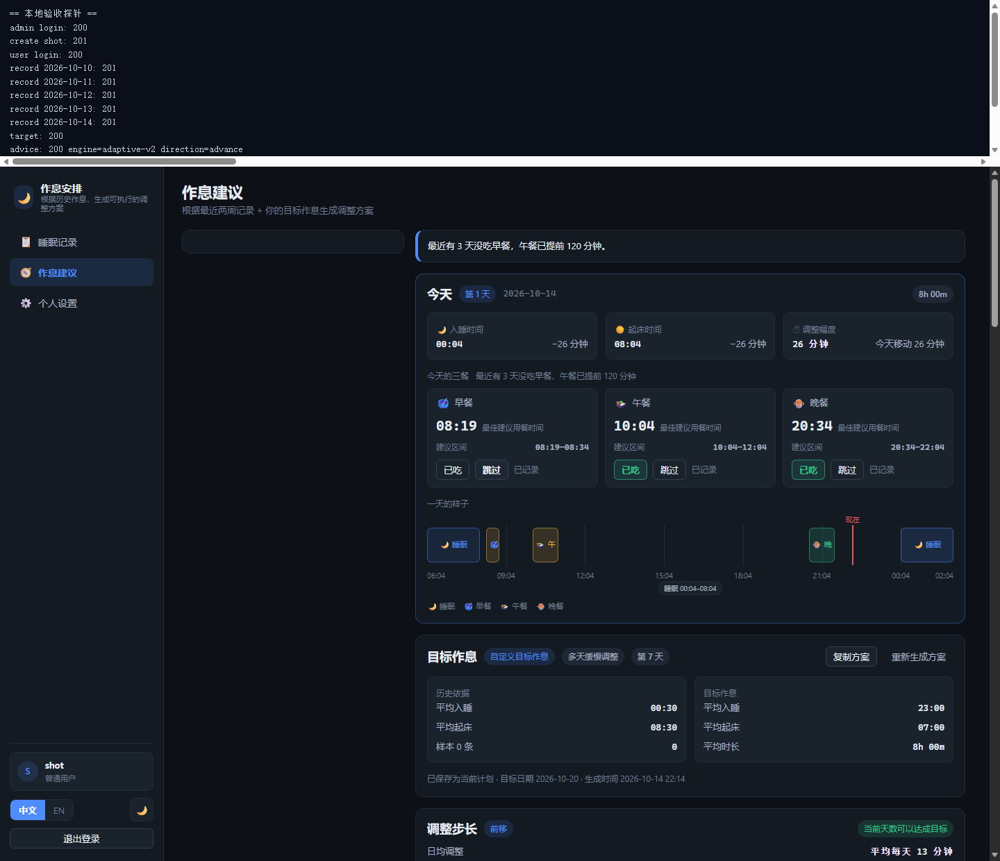
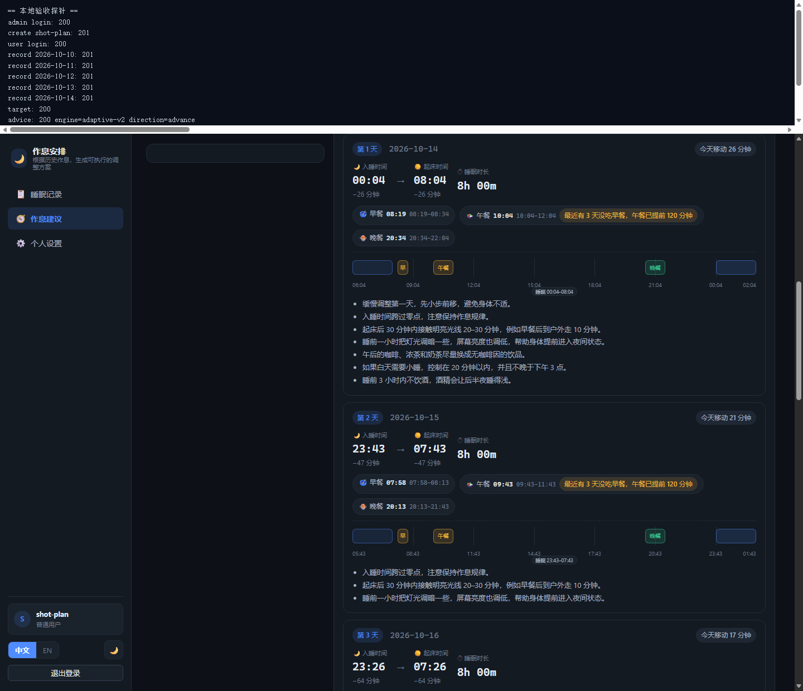
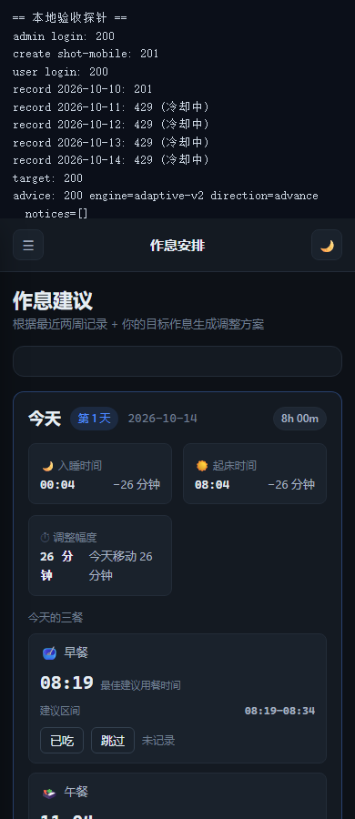

# Time To Sleep · 作息安排网站

根据历史睡眠记录，用基于公开文献的调整算法生成未来 1–30 天的**作息调整建议**与每日三餐建议时间，
并用一张 24 小时时间图把「今天该几点睡、几点起、几点吃饭」讲清楚。

**技术栈**：FastAPI · SQLAlchemy · SQLite(WAL) · 原生 ES Module + 原生 CSS（无构建步骤） · 单进程同时托管 API 与页面


[](https://github.com/Yiukiwhk/Time-To-Sleep/actions/workflows/ci.yml)

## 功能特性

### 用户端 `/user/`（响应式）

- **睡眠记录**：列表 + 录入，时间一律用滚轮选择器（无自由文本输入）；**入睡日期默认昨天，起床日期默认次日**（可改，未手动改过时跟着入睡日期走；一条记录因此跨两个日历日，三餐属于起床日）；支持日期区间筛选、增删改与勾选批量删除。
- **作息建议**（`adaptive-v2`）：1 天快速调整 / 多天缓慢调整（1–30 天），给出每日入睡、起床时间与当天调整幅度，可一键复制方案。
- **24 小时时间图**：宽屏横向、窄屏纵向，覆盖「起床前 2 小时 → 入睡后 2 小时」，跨零点自动环绕并标出「现在」。
- **三餐建议与一键确认**：给出三餐建议窗口（作息正常时午餐就近落在 11:00–15:00、晚餐落在 17:00–22:00），「已吃 / 跳过 / 不想吃」写回当天记录；连续跳过早餐会让午餐阶梯式前移。
  **点「不想吃」时午餐 / 晚餐时间在原地立刻更新**（先显示预先算好的结果并标出「旧 → 新」，打卡响应回来后再校正，不用刷新页面、也不用重新往下滚）。
- **偏离处理与达标统计**：≤30 分钟不打扰、30–90 分钟静默重算、>90 分钟弹窗；达标率与连续天数不计未记录的日子。
- **设置与账号**：中英文切换、深浅色主题、三餐开关、自定义目标作息、改密码、提交或撤销注销申请；页脚可查看参考文献。

### 管理后台 `/admin/`（仅 PC 布局）

- **概览**：用户数、记录数、待审核注销数、锁定账号数，以及一键手动清理。
- **用户管理**：搜索 / 过滤 / 分页，新建用户，启停账号、重置密码、解除锁定、删除用户。
- **多重密码管理员**：新建管理员时必须一并提供额外密码段，登录时逐段校验。
- **记录查看与注销审批**：按日期区间只读查看某用户的睡眠记录（可删除、**不允许修改**）；注销申请可批准或驳回并留下备注，重复处理会被拒绝。
- **系统日志**：按级别、事件、关键字、用户检索，带各级别计数。

### 算法引擎 `adaptive-v2`

- **步长先快后缓**：分段上限（60 → 45 → 30 → 15 分钟）逐段递减，实际步长取「该段上限」与「剩余偏移 ÷ 剩余天数」的较小值。
- **前移比后移保守**：前移每天至多 45 分钟，后移至多 90 分钟（前移受昼夜节律抵抗，有睡眠效率下降的证据）。
- **三餐只做节律锚点**：早餐锚起床、晚餐锚入睡（整体提前到睡前 4.5 小时）；作息正常时午餐与晚餐就近靠拢到社会时钟，越界则回落到相对锚点；午餐可因连续未吃早餐按 60 / 90 / 120 分钟阶梯前移（不早于起床后 2 小时）。三餐与达标率按记录的**起床日**配对。
- **偏离三档**：≤30 分钟静默、30–90 分钟静默重算（每天最多一次）、>90 分钟交由用户决策。
- **计划快照与重算**：生成即落库，偏离判定与达标率都以快照为基准；重算追加新快照，历史可追溯。
- **可解释的边界**：只有「相位移动速率」与「三餐不作为相位杠杆」两条有文献支撑，其余常量都是工程默认值。细节见 [docs/ALGORITHM.md](docs/ALGORITHM.md)。

### 安全与防护

- **Cookie 会话**：HttpOnly 会话 Cookie，用户端与管理后台互相隔离，30 天 / 12 小时两档有效期。
- **登录防爆破**：连续失败 5 次锁定 15 分钟，失败计数带时间窗口、成功登录后立即清零；每次失败都会提示「还可尝试几次」，锁定那次直接显示解锁倒计时。
- **写入冷却**：同一用户 10 秒内不能重复提交写入，前端倒计时 + 后端 `429 error.write_too_fast` 双重限制。
- **越权按不存在处理**：访问他人资源返回 404 而非 403，避免探测资源是否存在。
- **输入长度限制**：用户名、密码、备注等都有服务端上限（密码上限即 bcrypt 的 72 字节）。
- **数据保留**：每个用户仅保留最近 6 个月记录，过期会话与登录记录由定时任务清理。

## 界面截图


建议页桌面态：今日目标卡片 + 三餐卡片 + 一天的 24 小时时间图。


每日方案：逐日推荐的入睡 / 起床时间、迷你时间图与三餐徽标。


窄屏（390px）：时间图自动切换为纵向布局。

同一目录下还有：参考文献弹窗 [advice-references.png](docs/screenshots/advice-references.png)、偏离策略弹窗
[advice-deviation.png](docs/screenshots/advice-deviation.png)、记录页 [advice-records.png](docs/screenshots/advice-records.png)
与 [live-advice-records.png](docs/screenshots/live-advice-records.png)、线上建议页 [live-advice-base.png](docs/screenshots/live-advice-base.png)
与 [live-advice-plan.png](docs/screenshots/live-advice-plan.png)、线上参考文献 [live-advice-references.png](docs/screenshots/live-advice-references.png)、
本地窄屏 [advice-mobile.png](docs/screenshots/advice-mobile.png)、用户端登录 [live-user-login.png](docs/screenshots/live-user-login.png)
与主界面 [live-user-app.png](docs/screenshots/live-user-app.png)、后台登录 [live-admin-login.png](docs/screenshots/live-admin-login.png)
与概览 [live-admin-dashboard.png](docs/screenshots/live-admin-dashboard.png)。

## 快速开始

```bash
git clone https://github.com/Yiukiwhk/Time-To-Sleep.git && cd Time-To-Sleep
python -m venv backend/.venv                      # Windows 用 backend\.venv\Scripts\python.exe
backend/.venv/Scripts/python.exe -m pip install -r requirements.txt
backend/.venv/Scripts/python.exe scripts/bootstrap_deps.py   # 离线环境：免 pip 安装器
backend/.venv/Scripts/python.exe scripts/check_env.py        # 自检，应输出 failures: 0
backend/.venv/Scripts/python.exe run.py                      # 默认 0.0.0.0:8000，--reload 热重载
```

Windows 也可直接运行 `start.bat`（等价于用虚拟环境解释器启动 `run.py`）。首次启动会自动建库、写入
内置管理员，并启动「6 个月数据清理」定时任务。启动后：用户端 <http://127.0.0.1:8000/user/>、
管理后台 <http://127.0.0.1:8000/admin/>、健康检查 <http://127.0.0.1:8000/healthz>（返回 `{"status":"ok"}`）。

### 内置管理员（默认口令，上线后请立刻修改）

```text
用户名：admin
第 1 段密码（账号密码）：Admin@12345
第 2 段密码：Admin#67890
第 3 段密码：Admin$24680
```

管理员登录需要**三段密码全部正确**，缺一不可。第 1 段可在登录后从「设置 → 修改密码」修改；第 2/3 段
存在 `admin_credentials` 表，只能在**首次建库前**用环境变量 `SSP_BOOTSTRAP_ADMIN_PASSWORDS` 替换。
**这三段默认值是公开的，请务必在部署上线前全部改掉。** 本系统**没有自助注册**，普通用户由管理员在后台创建。

## 目录结构

```text
sleep-schedule/
├── run.py                  # 跨平台启动器（--host / --port / --reload / --no-browser）
├── start.bat               # Windows 一键启动
├── backend/app/
│   ├── main.py             # 应用工厂、中间件、静态托管、启动引导、定时清理
│   ├── config.py           # 全部环境变量与默认值（SSP_ 前缀）
│   ├── db.py               # 引擎 / 会话 / init_db（WAL + busy_timeout + 写入重试）
│   ├── models.py schemas.py errors.py
│   ├── api/                # 路由层：auth / records / advice / settings / account / admin
│   ├── services/           # 业务层：advice（算法）、advice_plan（快照/偏离/达标率）、auth、retention
│   └── core/               # security（bcrypt 与会话）、logkit（日志）、timing
├── frontend/               # 无构建：两个 SPA + 一份共享层
│   ├── user/               # 用户端（index.html + js/pages/{records,advice,settings}.js + css）
│   ├── admin/              # 管理后台（index.html + js/pages/{dashboard,users,logs,...}.js）
│   └── shared/             # 共享层：api / i18n / ui / timeline / timepicker / references / base.css
├── scripts/                # 自检与工具：check_env / bootstrap_deps / smoke_http / check_*
├── tests/                  # smoke_test / test_advice_engine / e2e_http / check_module_graph
├── deploy/                 # Nginx vhost、本地验收与发版脚本、只读诊断脚本
└── docs/                   # 算法 / API / 配置 / 开发 / 部署 / 参考文献 / 截图
```

## 算法概览（引擎 `adaptive-v2`）

- **先快后缓的步长曲线**：每天步长取「该段上限」与「剩余偏移 ÷ 剩余天数」的较小值，分段上限逐段递减（60 → 45 → 30 → 15 分钟），最后一天精确落到目标。
- **前移比后移保守**：前移每天至多 45 分钟，后移至多 90 分钟 —— 前移受内在昼夜节律抵抗，过快会出现入睡困难与睡眠效率下降。
- **三餐只做节律锚点**：早餐锚在起床后 15–30 分钟、晚餐锚在睡前 270 分钟（窗口 90 分钟，含整体提前 1 小时）、午餐取早餐与晚餐的中点再提前 60 分钟；进餐不作为相位杠杆。
- **饭点贴回现实时钟**：起床不晚于 15:00 时午餐就近靠拢进 11:00–15:00，入睡不晚于次日 06:00 时晚餐就近靠拢进 17:00–22:00；作息越界（15:00 后起床、或白天补觉）则整步跳过，沿用相对锚点。
- **连续未吃早餐会让午餐前移**：60 / 90 / 120 分钟阶梯，且不早于起床后 2 小时与现实窗口起点 11:00。
- **「不想吃」的结果先算好**：今日卡片带一份 `refusal_preview`（点了会变成的午餐 / 晚餐时间），前端点击瞬间就改数字，因此预测值必须与打卡后落库的时间逐字段一致。
- **偏离三档**：≤30 分钟静默接受；30–90 分钟静默重算（每天最多一次）；>90 分钟弹窗由用户在顺延 / 重算 / 保持中选择。
- **计划快照**：生成建议即落库，偏离判定与达标率都以快照为基准；未记录的日子不计入达标率、也不打断连续天数。

完整的规则、常量表与文献依据见 [docs/ALGORITHM.md](docs/ALGORITHM.md)。

## API 概览

| 方法 | 路径 | 说明 |
| --- | --- | --- |
| `POST` | `/api/auth/login` · `/api/auth/admin/login` | 用户端登录 / 管理员三段密码登录 |
| `GET` | `/api/auth/me` | 当前登录用户（`/api/auth/admin/me` 为管理员视角） |
| `POST` | `/api/auth/logout` · `/api/auth/password` | 退出登录（含管理员端口）/ 改密码（所有会话失效） |
| `GET` | `/api/records` | 睡眠记录列表（`start_date`、`end_date`、分页） |
| `POST` | `/api/records` | 新增睡眠记录（10 秒写入冷却） |
| `GET/PUT/DELETE` | `/api/records/{record_id}` | 单条记录的读取 / 部分更新 / 删除（`batch-delete` 批量删除） |
| `GET` | `/api/records/meta` | 可录入范围、保留策略与冷却剩余时间 |
| `POST` | `/api/advice` | 生成 1–30 天作息建议（可存为当前计划） |
| `GET` | `/api/advice/plan` | 读取当前计划快照 + 偏离 / 达标情况（`/api/advice/options` 为选项元信息） |
| `POST` | `/api/advice/checkin` · `/api/advice/replan` | 三餐确认 / 偏离过大时选择策略重算 |
| `GET/PUT` | `/api/settings` · `/api/settings/target` | 语言主题与三餐开关 / 自定义目标作息（必须成对设置） |
| `GET/POST/DELETE` | `/api/account/deletion` | 查询 / 提交 / 撤销注销申请 |
| `GET/POST/PATCH/DELETE` | `/api/admin/users…` | 用户管理（含重置密码、解锁、删除与记录只读查看） |
| `GET` | `/api/admin/logs` · `/api/admin/stats` | 系统日志检索与概览统计 |

请求 / 响应示例、字段含义与完整错误码表见 [docs/API.md](docs/API.md)。

## 测试与自检

```bash
# 后端接口冒烟（进程内 TestClient，独立临时库）+ 算法引擎单元测试（15 项）
backend/.venv/Scripts/python.exe tests/smoke_test.py
backend/.venv/Scripts/python.exe -m pytest tests/test_advice_engine.py -q
# 真实服务端到端（需先启动服务）+ 静态资源与路由冒烟
backend/.venv/Scripts/python.exe tests/e2e_http.py http://127.0.0.1:8000
backend/.venv/Scripts/python.exe scripts/smoke_http.py http://127.0.0.1:8000
# 静态检查：i18n key 覆盖、CSS 类名覆盖、漏写的 import
python scripts/check_i18n_keys.py && python scripts/check_css_classes.py && python scripts/check_frontend_imports.py
# 一键本地整体验收（起服务 + 便携 Nginx + 无头 Edge 七档场景 + e2e）
powershell.exe -NoProfile -ExecutionPolicy Bypass -File .\deploy\accept_local.ps1
```

改动前端或算法后建议跑最后一条，它会顺带跑五条回归护栏（无漏翻 i18n key、无未填充占位符、时间条不压
刻度与图例、登录失败预警剩余次数、成功登录清零失败计数）。命令逐条说明见 [docs/DEVELOPMENT.md](docs/DEVELOPMENT.md)。

## 部署

单机部署：Nginx 监听 80 直接读取 `/var/www/sleep-schedule` 下的静态文件，`/api/` 与 `/healthz` 反代到
`127.0.0.1:8011` 上由 systemd 托管的 uvicorn 进程（应用目录 `/opt/sleep-schedule`，服务用户 `sleepapp`，
SQLite 放在 `/var/lib/sleep-schedule/app.db`），按需求**未启用 HTTPS**。

- 本地先用 `deploy/verify_nginx.ps1 -WithBackend` 验证 vhost 路由，再发版。
- 发版走 `deploy/apply_fix.ps1`（暂存 → 上传 → 远端 rsync 与装 vhost → 重启 → 断言），出问题按回滚清单处理。
- 上线后先改内置管理员的三段密码，再过一遍健康检查与线上端到端。

拓扑细节、Nginx 关键点、发版检查清单、回滚与运维要点见 [docs/DEPLOYMENT.md](docs/DEPLOYMENT.md)。

## 参考文献

算法中的相位移动速率与「三餐只做节律锚点」两条硬约束都有文献支撑，其余常量是工程默认值；四篇依据
文献（含 DOI）见 [docs/REFERENCES.md](docs/REFERENCES.md)。

## 免责声明

本项目的作息建议来自**公开文献的群体统计规律**，仅供参考与自我管理使用，**不构成医疗建议**，也不能
替代专业诊断与治疗。若你存在长期入睡困难、睡眠呼吸暂停、昼夜节律紊乱等睡眠障碍，请及时就医并遵从
医生的专业意见。使用本项目产生的任何后果由使用者自行承担。

完整条款（中英双语）见 [DISCLAIMER.md](DISCLAIMER.md)。

## 许可证

本项目基于 [MIT 许可证](LICENSE) 发布，可自由使用、修改与分发（请保留版权与许可声明）；
健康免责声明见 [DISCLAIMER.md](DISCLAIMER.md)。

## 贡献

1. Fork 仓库并从 `main` 切出分支：功能用 `feat/<主题>`，修复用 `fix/<主题>`，文档用 `docs/<主题>`。
2. 改动前端时遵守硬约束：模块说明符写站点绝对路径（`/shared/...`）、文案一律走 `t()/tp()`、新增 CSS
   类要过 `check_css_classes.py`，改完跑 `check_frontend_imports.py`。
3. 提交前跑一遍自检（冒烟 + pytest + 静态检查）；改前端或算法时再跑 `deploy/accept_local.ps1`，并在 PR 里贴结果。
4. 提交信息用祈使句并带范围，例如 `fix(records): 修正新增记录弹窗未关闭的问题`；一个 PR 只做一件事。
5. 涉及算法常量的改动请同步更新 [docs/ALGORITHM.md](docs/ALGORITHM.md) 的常量表。

## 致谢

感谢 FastAPI、SQLAlchemy、Uvicorn 等开源项目，以及 [docs/REFERENCES.md](docs/REFERENCES.md) 中四篇文献
的作者为作息调整提供的实证依据。
